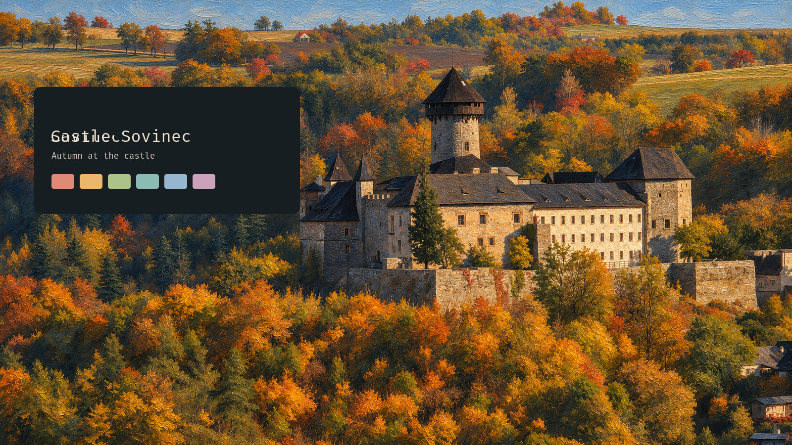

# Castle Sovinec

A dark Omarchy theme inspired by autumn at Sovinec Castle in Czechia. Slate surfaces, warm limestone text, and an amber accent complement three painterly wallpapers.



## Install

```sh
omarchy theme install https://github.com/Morganczech/omarchy-castle-sovinec-theme.git
```

Cycle through the oil painting, gouache, and watercolor wallpapers with `omarchy theme bg next`.

## License and credits

- The theme configuration and documentation are licensed under the [MIT License](LICENSE).
- The wallpapers in `backgrounds/` and the repository preview `preview.png` are licensed under [CC BY 4.0](https://creativecommons.org/licenses/by/4.0/).

Original photographs of Sovinec Castle by [Morganczech](https://github.com/Morganczech). The wallpapers are AI-assisted painted adaptations of those photographs.

Suggested credit: “Castle Sovinec wallpapers, adapted from photographs by Morganczech, CC BY 4.0.”
